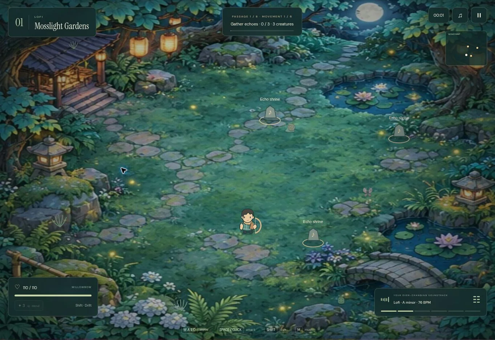
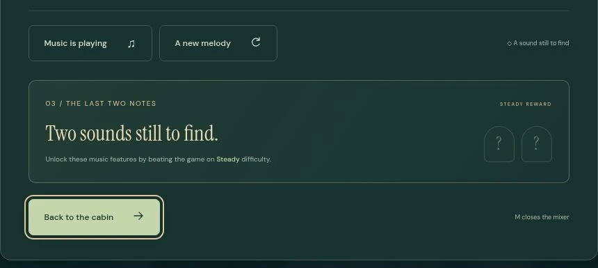
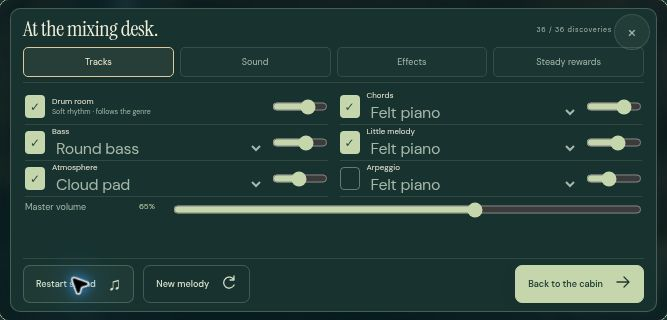

# Stillwave

**[Play Stillwave](https://jh124.github.io/Don-t-play-This-Game/)**



A musical action roguelike with a small cabin to come home to. Wander through six illustrated worlds, bind permanent Waychimes, and bring new sounds back to your studio. This replaces the original tower-defense game; its source remains in Git history.

## The journey

| Movement | World | Musical palette | Guardian |
| --- | --- | --- | --- |
| 1 | Mosslight Gardens | Lofi | The Lantern Keeper |
| 2 | Afterglow City | Synthwave | The Midnight Rider |
| 3 | Littlebit Ruins | Chiptune | The Forgotten Cartridge |
| 4 | Sundrift Coast | Bossa | The Pearl Leviathan |
| 5 | Cloudrest Monastery | Ambient | The Keeper of Silence |
| 6 | The First Light | Downtempo | The Sun in Bloom |

Each world contains eight passages and a distinct, two-phase guardian. Each passage unfolds through six encounters over at least 75 seconds. Collect the three echo shrines and clear the creatures to open the north gateway. Three echo shrines are scattered independently across the walkable map, with spacing from one another, the arrival point, and the exit. Encounters, scenery details, and musical arrangements also vary with the journey seed. Some passages have a gentle movement boost or a bonus healing bloom.

The 48 passages alone take at least 60 minutes of active simulation, before boss fights and exploration. A first clear is designed for about 70–90 minutes, although actual player pacing has not been established through an hour-long human playtest. The game pauses in the background. Save & return to the cabin lets you take longer breaks.

Pick one companion for a run:

- **Moonblade:** 36 damage per hit, 0.62-second base recovery, broad cleave, 120-unit reach, and 1 health restored every third successful swing. Better damage, more exposure.
- **Willowbow:** 22 damage per hit, 0.48-second base recovery, 580-unit reach, arrows that can hit two enemies. More room to dodge, lower damage.

Attack recovery and travel time create measured base single-target rates 55.8 and 44 damage per second respectively in the 20-second stationary-target regression scenario. Both weapons receive the same Waychime upgrades. **Gentle** uses the former Steady balance without reducing damage or enemy speed. **Steady** starts slightly tougher and grows considerably harder across the journey: more enemies, higher concurrent enemy limits, and increasing health and damage. In the final world, enemies have roughly three times the Gentle health and over twice the damage. All enemy attacks have a wind-up. Drifting briefly grants invincibility.

Echo shrines heal for 8, dropped hearts heal for 10, completed passages heal for 16, and mending herbs heal for 45. A guardian heals for 40, and entering a new world restores health. After passages 3 and 6 in every world, find a **Waychime**. These twelve uniquely named runes stay with you after death. Each holds one blessing: +13% weapon damage, +18 maximum health, +5.5% movement speed, or 7% faster attack recovery (capped at 45%). Every bound blessing is active from the start of a fresh journey. Revisit the same clearing to keep its blessing or replace it; each rune contributes exactly once. The on-screen rack shows all twelve as simple diamonds, with undiscovered marks greyed out. Bound diamonds use the blessing color: coral for damage, green for health, blue for movement, and gold for attack speed. Open it for the named collection and each rune’s blessing.

## Your musical collection

There are 36 collection entries, including the starting Lofi palette. Echo bearers appear in passages 2, 4, 6, and 8 of every world. Chordkeepers summon companions, Tempo Wanderers charge, Echo Weavers scatter notes, and Meter Wardens release circular patterns. Defeat them to unlock one of the 24 track/control discoveries. Each guardian unlocks its instrument and genre palette.

Unlocks include bass, melody, atmosphere, and arpeggio tracks; instruments; six keys; minor, major, Dorian, and pentatonic scales; 4/4, 3/4, 6/8, and 5/4; tempo from 60–96 BPM; swing; reverb; tape delay; warmth; and arrangement density. Swing shifts offbeat eighth notes throughout the active arrangement, up to a gentle 2:1 shuffle. Tape delay adds audible, tempo-synced repeats with filtered feedback. Notes share a diatonic harmonic progression. Music is composed locally with seeded motifs, changing phrases, synthesized instruments, and genre-specific rhythms. There is no prerecorded music loop and no timing requirement for combat.

Discoveries are added to two places: this journey’s musical palette and your permanent cabin collection. After death, a fresh journey starts with the basic music palette and a new arrangement; your chosen Waychime blessings remain active. The cabin retains every discovered sound and its own saved musical arrangement. Changing the journey mix does not overwrite your studio mix. Master volume, mute, and accessibility preferences apply everywhere. Your current run, its palette and mix, Waychimes, completed guardians, and cabin collection save automatically in browser localStorage. Save & return to the cabin resumes at the **start of the current passage**, with saved health, herbs, weapon, Waychimes, run music, and elapsed run time. Old archives and saved combat upgrades are migrated into the new progression system. This is a device-local save; clearing browser storage removes it.

## Your cabin studio

The start and end of the journey are the same place: a warm illustrated cabin, with the traveler seated at a table between a pair of speakers and a mixing desk. Hover or keyboard-focus the mixer to open music settings; hover or focus the door to choose a weapon, choose a difficulty, or resume a saved journey. Touch layouts also provide explicit Mixer and Play buttons. The studio is available from the beginning and grows as you discover sounds.

Complete the six guardians and enter the final gateway to return home with the **regular studio palette unlocked**. Every genre, instrument, track, key, meter, tempo control, and effect becomes available. Change track levels and arrangement density, or request a new melody for another seeded composition. Two additional, permanent studio music features are exclusive to finishing **Steady**. Until a Steady clear, the bottom of the mixer shows a generic locked section; it does not display the rewards’ names or controls. Finishing Gentle, collecting every regular sound, or selecting Steady does not unlock them. Once earned, their settings save with the cabin mix, independently of fresh journeys. Existing saves retain their progress; old completion records do not identify the difficulty of the winning run, so they leave the new rewards locked. There is no song download or export screen.



The cabin remembers its own genre, arrangement seed, instruments, and effects independently of the active journey. During a journey, its world sets the genre and regional chord tone; other controls become available as echo bearers are defeated. Desktop gameplay has no echo map, so exploration relies on the world itself. The compact map remains on small touch screens, beneath the world label.

## Controls

| Action | Desktop | Touch |
| --- | --- | --- |
| Move | WASD / arrows | Left stick |
| Aim and attack | Hold left click, aim with mouse | Hold Attack, automatic nearby aim |
| Attack with assisted aim | Hold Space | Hold Attack |
| Drift | Shift / right click | Drift |
| Heal | Q / Mend button | Mend button |
| Gather echo / use gateway | E / on-screen button | Gather / Continue |
| Music panel | M to open or close / music dock | Music dock |
| Pause | Escape / pause button | Pause button |

Assisted aim for Space and reduced motion are configurable in Pause. Music continues while a visible pause or music panel is open, and suspends when the tab is hidden. Browsers require an initial interaction before playing sound. If your OS suspends audio, resume through the visible music controls.

## Mobile play

Phone play is designed for landscape, with a compact HUD and touch controls at the edges. Portrait opens a rotate prompt and pauses an active journey. On supported devices, entering through the door requests full screen and a native landscape lock. Safari may decline orientation locking; the rotate prompt enforces the landscape layout without rotating the controls artificially. Installed applications also request landscape through the web manifest.

The phone mixer has Tracks, Sound, Effects, and Steady rewards pages, with the sound and return buttons always visible. Collections use pages instead of a long phone scroll. The cabin, weapon choices, pause menu, and Waychime choices use the available landscape width. The diamond rack keeps its total collection count, with no per-upgrade counts.

Audio starts directly from a user gesture. Where the browser supports Audio Session, Stillwave requests music playback instead of the default ambient route. Interrupted or suspended contexts can resume from a tap; the sound button reflects actual playback state. Restart sound rebuilds an unresponsive audio context without changing your saved arrangement. Backgrounding the page suspends playback, and stale scheduled bars are discarded when returning.



## Development

No runtime packages, build dependencies, or backend are required. Node 22+ is used for the small build script and tests.

```sh
npm test
npm run build
```

Serve `dist/` with a static web server. ES modules require HTTP; opening `index.html` directly as a file is not supported. The only optional external resource is the Google Fonts stylesheet; system serif and sans-serif fallbacks are provided.

Source layout:

- `index.html`, `styles.css`, `mobile.css`: interactive cabin, game HUD, Waychime rack, dialogs, mixer, and touch controls.
- `js/engine.js`: seeded world simulation, encounters, weapons, enemies, guardians, and progression.
- `js/music.js`: composition, Web Audio synthesis, live effects, and development audio encoding.
- `js/data.js`: worlds, musical palettes, unlocks, Waychimes, difficulty curves, weapons, and deterministic helpers.
- `js/save.js`: validated browser archive and run persistence.
- `js/render.js`, `js/sprites.js`: illustrated-world rendering and original vector characters.
- `js/app.js`, `js/ui.js`, `js/mobile.js`: input, cabin/run music separation, interface, audio integration, mobile orientation, and lifecycle.
- `assets/worlds.webp`, `assets/cabin.webp`: original generated environments and cabin illustration.
- `tests/mobile.test.mjs`: audio startup, interruption recovery, playback status, scheduler recovery, and landscape guard checks.
- `tests/game.test.mjs`: behavioral checks for progression, permanent runes, save migration, separate music palettes, difficulty curves, harmony, and combat.
- `tests/audio-effects.html`: local-only Web Audio checks for swing, echoes, live delay changes, the two Steady rewards, and unclipped output across all genres with every effect active.
- `tests/browser.html`, `tests/qa-controls.js`: local-only cabin, rune, retuning, death, and victory fixtures. Run `npm run qa`, serve `dist/`, and open `/qa.html`. Controls exercise real game events. Rebuild before publication to remove the fixture pages.

GitHub Actions runs the tests, builds `dist/`, and publishes it to the repository’s existing GitHub Pages site on pushes to `main`. The repository name and public address are unchanged.
